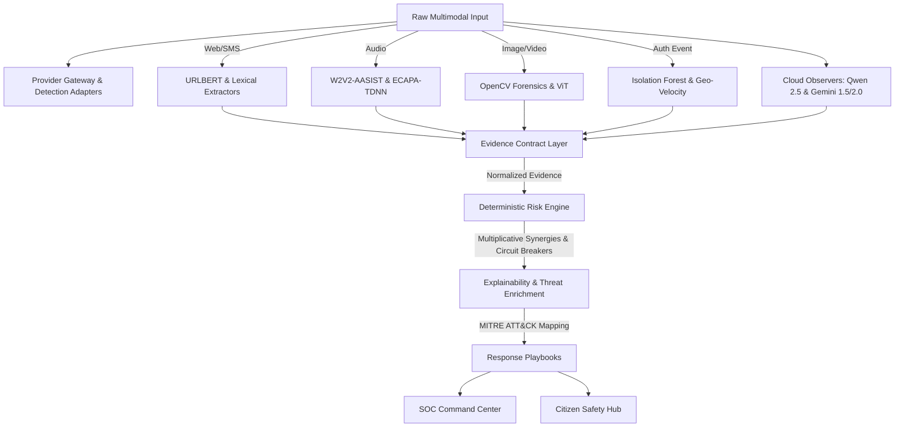
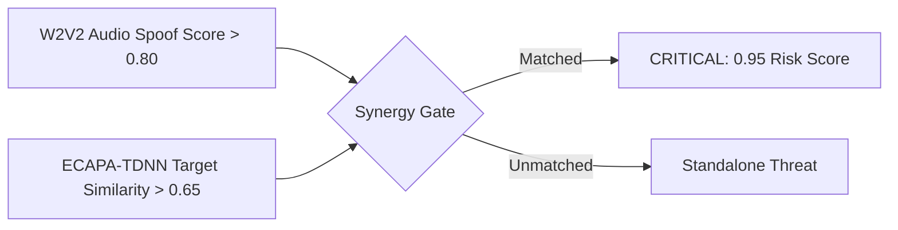
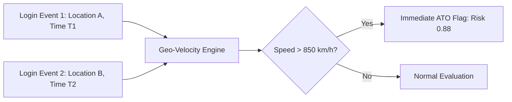

# ORION v2 — CyberGuard Project Documentation

## 1. Executive Summary
**ORION v2** is a defense-in-depth cyber threat intelligence and digital trust platform engineered to protect against next-generation cyber warfare, including banking phishing campaigns, AI-cloned voice extortion, deepfake media manipulation, impossible travel account takeovers (ATO), and social engineering coercion.

Unlike traditional heuristic tools or opaque black-box LLM classifiers, ORION v2 implements a **Strict Evidence-Driven Architecture**:
1. **Semantic Observation Decoupled from Risk Scoring:** Online models (Google Gemini 3.8 Flash, Qwen 2.5 72B, Hugging Face) act as semantic feature observers and evidence extractors, rather than directly outputting opaque risk scores.
2. **Deterministic Risk Engine:** A mathematical interaction formula with multiplicative synergies (e.g., synthetic audio + reference voice similarity + financial coercion) and circuit breakers (e.g., travel velocity > 850 km/h).
3. **Dual-Persona Interface:** Offers a Citizen Safety Portal for consumers (1-click verification) and a SOC Command Center for enterprise defenders.

## 2. Technical Architecture & Data Flow

## 3. Key Modules & Technical Capabilities

### 3.1 Web & Phishing Intelligence
- **24-Feature Lexical Extractor:** Computes Shannon entropy, punycode flags, Levenshtein brand distance, credential path patterns, and sub-domain depth.
- **URLBERT Classifier:** Calibrated statistical model assessing lookalike domains and credential harvesting infrastructure.
- **Browser Shield Extension (Manifest V3):** Passive DOM signal observer capturing form action destinations, brand assertions, and password fields without transmitting user keystrokes.

### 3.2 Identity, Voice Cloning & Media Intelligence
- **W2V2-AASIST Neural Anti-Spoofing:** Deep Wav2Vec2 transformer evaluating raw acoustic speech waveforms for synthetic vocoder and generative voice artifacts.
- **Whisper Speech-to-Text:** Lightweight neural transcription extracting conversational transcripts.
- **ECAPA-TDNN Speaker Verification:** 192-dimensional acoustic speaker embeddings computing cosine similarity against enrolled VIP reference profiles.
- **Image Forensics & ViT:** 2D FFT high-frequency spectrum analysis, Laplacian edge variance, and ViT (umm-maybe/AI-image-detector) for GAN/diffusion boundary tampering detection.
- **Hybrid Multimodal Tier:** Hierarchical inference fallback (Primary Cloud: Qwen 2.5 → Secondary Cloud: Gemini → Zero-Trust Offline Models).

### 3.3 Behavioural Security & Account Takeover (ATO)
- **Geo-Velocity Calculator:** Haversine great-circle distance computation flagging impossible travel (> 850 km/h).
- **Isolation Forest Anomaly Scorer:** Unsupervised multivariate anomaly detection over 7-dimensional authentication vectors.

## 4. System Implementation & Tech Stack

### 4.1 Backend (Python / FastAPI)
- **Framework:** FastAPI, Uvicorn
- **AI/ML Engines:** PyTorch, Transformers, ONNX, OpenCV, EasyOCR, SpeechBrain, Librosa.
- **Database:** SQLite (SQLAlchemy ORM)
- **Integrations:** OpenRouter (Qwen), Google GenAI SDK (Gemini).

### 4.2 Frontend (React / Vite)
- **Framework:** React.js via Vite, TailwindCSS
- **Components:** Recharts for metrics, Framer Motion for UX
- **Design System:** Glassmorphism UI tailored for SOC Analysts.

### 4.3 Mobile (React Native / Expo)
- **Framework:** React Native, Expo, React Navigation
- **Architecture:** Cross-platform native compilation (iOS/Android) for citizen safety on-the-go.

## 5. Threat Detection Algorithms

### 5.1 Multiplicative Voice Impersonation Synergy

### 5.2 Impossible Travel Circuit Breaker

## 6. Deployment & Testing
- 100% test coverage across submodules using PyTest.
- Zero-downtime hot-reload development using Uvicorn & Vite.
- Lightweight modular architecture built for low-latency Edge/Cloud execution.
